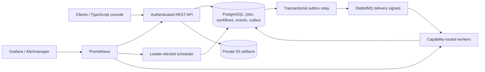
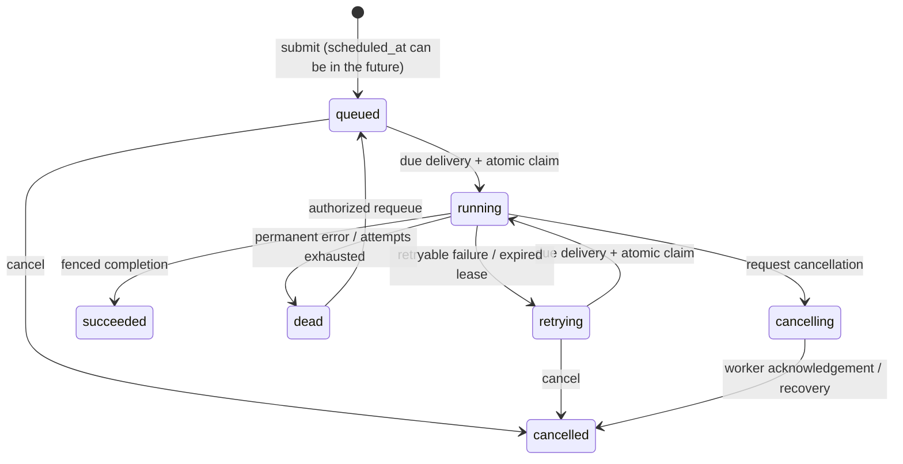
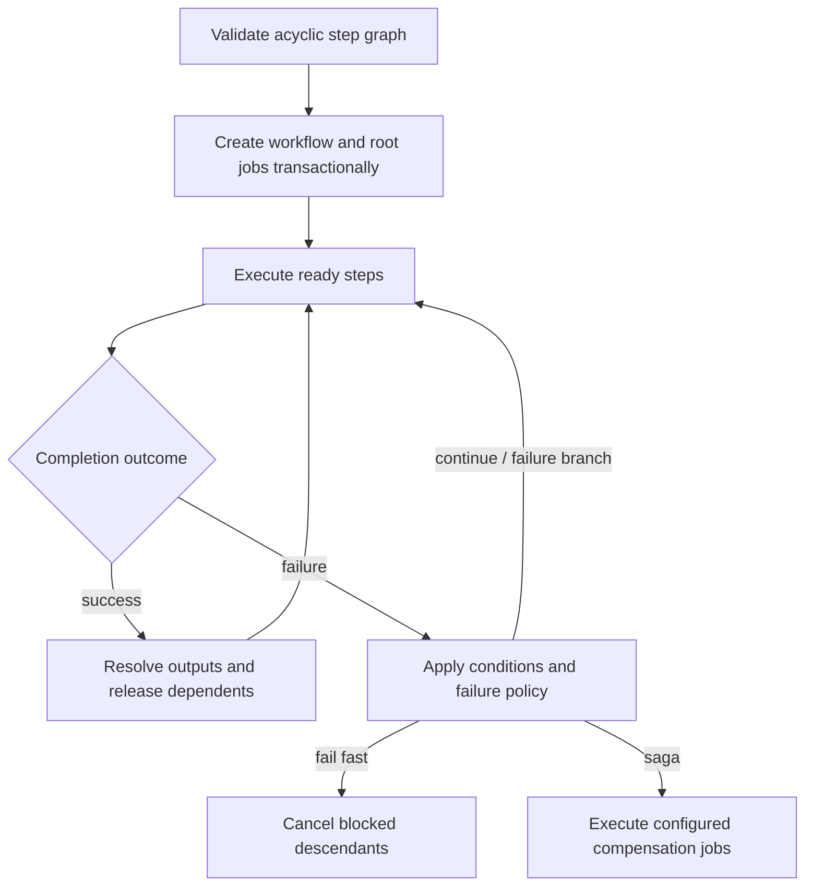

# Architecture

ForgeQueue uses PostgreSQL as the source of truth and RabbitMQ as the delivery signal.

## Delivery and recovery model

- Delivery is **at least once**. Workers atomically move a queued job to running before executing it.
- A repeated delivery cannot execute a job that is no longer queued.
- A renewable lease protects work owned by a worker. If that worker crashes, scheduler recovery changes expired work to retrying and queues another delivery. Lease tokens fence stale completion attempts; this does not make external handler side effects exactly once.
- Submission and its outbox entry commit together. The relay may publish twice if it crashes between publish and marking the row, which is safe because claiming is guarded by job state.
- An idempotency key gives clients exactly-one logical submission within the retained job history.
- Failed attempts use the configured fixed, linear or exponential backoff, optional jitter and caps. Permanent errors and exhausted attempts enter the `dead` state for inspection.

Built-in handlers include `echo`, `sleep`, and opt-in `command`. Running arbitrary commands is intended for isolated demo workers only; production deployments should register trusted typed handlers instead. Workers may subscribe to multiple queues and advertise capabilities. Per-queue pause/concurrency controls and per-principal quotas constrain dispatch and submission.

## Job state machine

## Workflows and recovery

Dynamic fan-out creates durable child steps and fan-in waits for their outputs. Cancellation, attempt history and bounded progress/log events are retained in PostgreSQL. SSE is a resumable view of durable events, not the delivery transport. Artifacts store bytes privately in object storage and metadata in PostgreSQL; failed deletion preserves metadata for a later cleanup attempt. Signed download URLs expire, and ownership is checked before issuance.

Two or more scheduler replicas can run, but a PostgreSQL advisory lock permits one active leader. Standbys take over after leadership is lost. KEDA scales workers from RabbitMQ backlog; PostgreSQL remains authoritative if the broker is unavailable. OpenTelemetry links API, relay and worker operations; Prometheus alert rules cover backlog, failures, leases, workers, leadership and stalled outbox records.

Interval schedules are implemented. Cron/time-zone schedules, durable signed webhooks, multipart/streaming artifacts, backup-safe reconciliation and measured production-scale claims are **not** implemented yet. See [implementation checklist](../implementation-plan.md), [improvement roadmap](../improvements.md), [deployment](../deploy/kubernetes/README.md) and [disaster recovery](disaster-recovery.md) for exact status and operational limitations.
